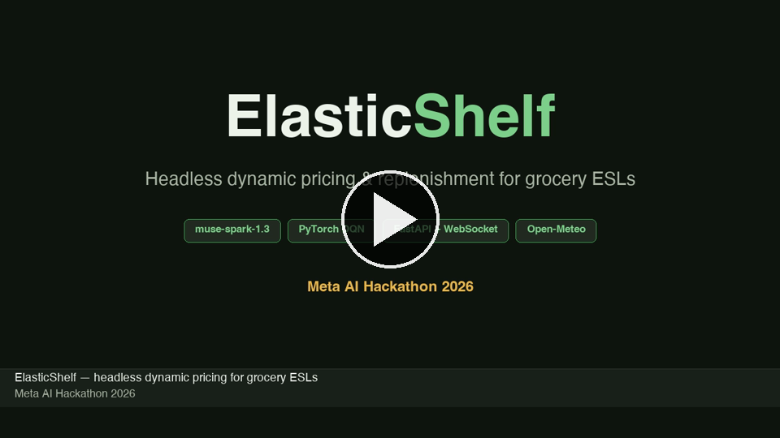
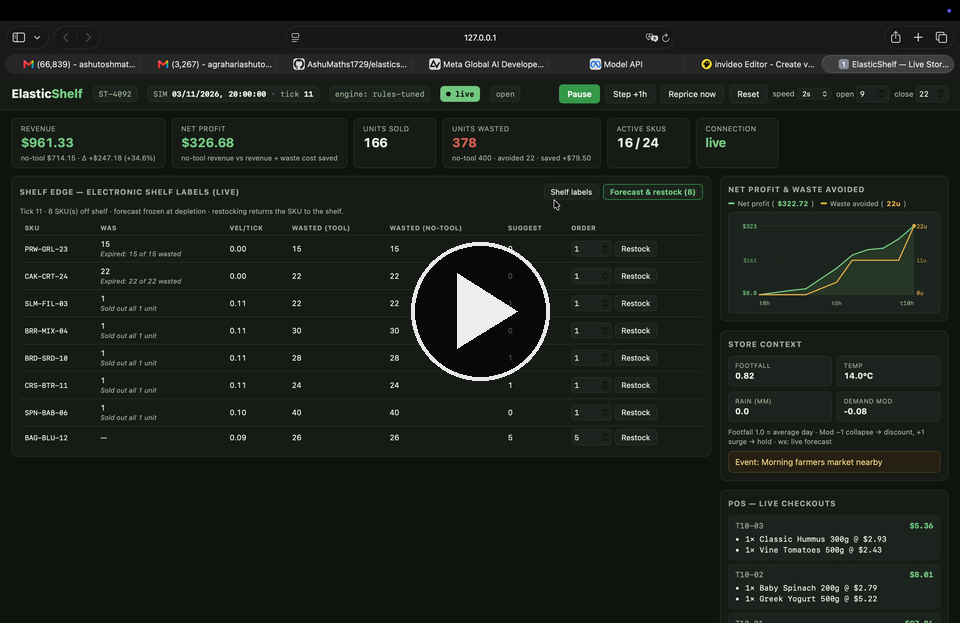
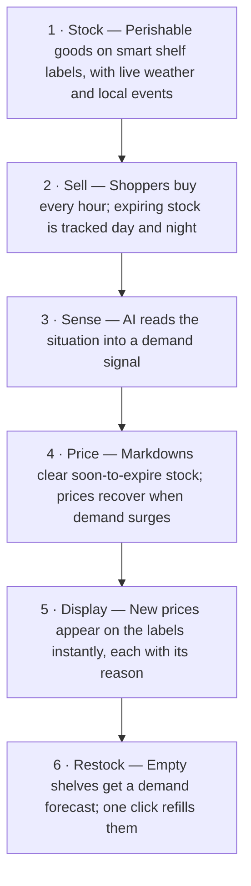

# ElasticShelf — Headless Dynamic Pricing & Replenishment for Grocery ESLs

> **Meta AI Hackathon 2026** · Built by **Ashutosh ([@AshuMaths1729](https://github.com/AshuMaths1729))** — AI/ML Engineer building autonomous retail pricing, reinforcement learning, and LLM decision systems.

[-0668E1?style=for-the-badge&logo=meta&logoColor=white)](https://dev.meta.ai/docs/quickstart)
[](https://pytorch.org/)
[](https://fastapi.tiangolo.com/)
[](https://developer.mozilla.org/en-US/docs/Web/API/WebSockets_API)
[](https://www.python.org/)
[](https://numpy.org/)
[](https://docs.pydantic.dev/)
[](https://open-meteo.com/)
[](#architecture)

ElasticShelf is a headless pricing and replenishment intelligence layer that sits between grocery POS/ERP systems and Electronic Shelf Labels (ESLs), paired with a full-auto live store simulator and WebSocket storefront.

Every simulated hour (default `2s` wall-clock = `1h` sim-time), the engine steps through live **Open-Meteo** weather forecasts, local events, and store-hour schedules; evaluates per-SKU demand modifiers with **Meta Muse (`muse-spark-1.3`)** over retrieved store context; prices perishable inventory using **PyTorch Deep Q-Networks (DQN)**, **Pareto-tuned rules**, or **Model Predictive Control (MPC)**; pushes hardware-formatted updates to the ESL wall; and forecasts replenishment quantities with **Muse** the moment a SKU sells out or expires.

---

## Demo Video

**Narrated Demo (~3:27)** — male voiceover with captions throughout:

[](demo/elasticshelf-demo.mp4)

**Raw screen capture (~0:52)** — unedited screen recording:

[](demo/demo-recording.mov)

The narrated film tours the live store UI (shelf labels, store context, POS feed, profit chart, forecast and restock), the overnight and tick workflow, and the models underneath (Muse context, DQN pricing, rules and MPC) — every number rendered from a real 90-tick engine run.

---

## Architecture

| Module | Role | Implementation |
|---|---|---|
| **A. Ingestion & Normalization** | `POST /api/v1/inventory/sync` | `backend/main.py` + `backend/models.py` — normalizes POS/ERP payloads into `InventoryItem` records and mirrors stock into the counterfactual baseline twin |
| **B. Context Engine (Muse + RAG)** | Situational demand modifier & restock forecasting | `backend/context_engine.py` — `muse-spark-1.3` via Meta Model API Chat Completions over a keyword-retrieval corpus; deterministic heuristic mock and rule fallback when offline |
| **C. Elasticity Engine** | Dynamic markdowns & margin recovery | `backend/elasticity.py` + `backend/pricing_env.py` — selectable policy (`tuned-rule`, `dqn`, `mpc`, `rule`, or `auto`), mapping state + Muse modifier to `[-10%, -5%, 0%, +5%]` |
| **D. ESL Bridge** | Edge hardware payload delivery | `backend/esl_bridge.py` — formats price updates into `generic`, `vusion` (VusionGroup), or `pricer` payloads with acknowledgement logging |
| **Store Simulator & Baseline Twin** | Full-auto store + counterfactual ledger | `backend/simulator.py` + `backend/store.py` — clock, store-hours gating, Open-Meteo weather series, paired-draw POS basket generator, depletion tracker, `history` time series, and a static-price "no-tool" twin |
| **Live Storefront** | ESL fleet + POS + Trend Chart + Restock console | `frontend/` — e-ink ESL grid, dual-scale **Net Profit & Waste Avoided** SVG line chart, live POS checkout feed, store context monitor, ESL push audit, and the **Forecast & restock** tab (`/ws/stream` + REST fallback) |

---

## End-to-End Working Flow



_Behind the scenes, a no-tool twin mirrors the store at static prices, so every dollar of gain is provably from pricing. The [demo video](#demo-video) walks through all six stages live._

### Step-by-Step Lifecycle

1. **Startup & Weather Ingestion**
   - On startup (`backend/main.py`), `.env` is loaded, the 24-SKU perishable catalog (`data/catalog.json`) is seeded into `Store`, and `Simulator` loads the 72-hour hourly temperature and precipitation series fetched from the **Open-Meteo API** (`data/weather.json` via `scripts/fetch_open_data.py` for `STORE_LAT`/`STORE_LON`). If the forecast file is absent, the simulator falls back to a seeded random weather walk (`weather_source: "walk"` vs `"forecast"`).

2. **Tick Progression & Store-Hours Gating**
   - Each tick advances `sim_time` by `hours_per_tick` (default `1h`) and steps weather to the next hourly Open-Meteo reading.
   - **Perishable Expiry:** Any SKU whose `expiration_timestamp <= sim_time` immediately books its remaining shelf stock as waste (`units_wasted`, `waste_cost`, `waste_by_sku`) — even when the store is closed overnight.
   - **Store Hours:** Trading is gated by `open_hour` and `close_hour` (default `09:00–22:00`, configurable live in the UI, supporting overnight wrap such as `20:00–02:00`). Closed ticks skip POS sales and repricing.

3. **Dual-World POS Demand, Paired Counterfactual Draws & Net Profit Chart**
   - While open, footfall is computed from the time-of-day curve modulated by rain penalties (`≥ 1mm × 0.88`, `≥ 5mm × 0.70`) and local events (stadium match surge `× 1.30`, food festival diversion `× 0.75`).
   - **Live Store (With Tool):** Draws price-elastic sales per SKU where discounts lift demand and price hikes curb it, plus a `1.4×` urgency boost within 24h of expiry. Individual sales are bundled into checkout tickets (`pos_feed`).
   - **Counterfactual Twin (No Tool) with Paired Shopper Draws:** Shadows the exact same catalog and restocks at fixed `base_price`. Both worlds share the **same unit-exponential shopper arrival draw** (`draws[item.sku]`) per SKU per tick (Common Random Numbers), eliminating RNG variance so every dollar of difference in revenue and waste comes strictly from the pricing policy.
   - **Net Profit Over No-Tool:** Both worlds track revenue and waste costs (`waste_cost = wasted_units × cost_basis`), and the **Net profit** card displays `Net Profit = (Tool Revenue − No-Tool Revenue) + (No-Tool Waste Cost − Tool Waste Cost)` (`no-tool revenue vs revenue + waste cost saved`) — showing how waste cost savings outweigh any revenue dip from markdowns.
   - **Dual-Scale Live Trend Chart:** Every tick appends `{tick, profit, waste_avoided}` to `sim.history`, rendered in the **Net Profit & Waste Avoided** SVG line chart above `Store Context` (`renderTrendChart` in `frontend/app.js`) with a shared time X-axis (`t0h` → `t{tick}h`) and independent auto-scaling left (`USD`) and right (`units`) Y-axes.

4. **Contextual Demand Assessment (Retrieval + Fast Per-Tick Scorer / Optional Muse Call)**
   - During `evaluate_pricing()`, `ContextEngine.retrieve()` scores the in-memory corpus of weather alerts, local events, and historical pricing notes by token overlap with the SKU's category and current conditions.
   - To keep the 2-second simulation loop and UI controls (**Start**, **Step +1h**, **Reprice now**) responsive at **~1–6 ms per tick** across all 24 SKUs, per-tick pricing runs `ContextEngine.demand_modifier(..., use_llm=False)`, which uses `ContextEngine._mock_reason()` to deterministically compute the modifier in `[-1.0, +1.0]` and reasoning from rain, footfall, temperature, category, event, and expiry rules.
   - Passing `use_llm=True` to `demand_modifier()` invokes **Meta Muse (`muse-spark-1.3`)** at `${MUSE_BASE_URL}/chat/completions` (`reasoning_effort="low"`) for a two-line `MODIFIER:` / `REASON:` assessment, falling back to `_mock_reason()` if offline.

5. **Elasticity Decision, Guardrails & ESL Hardware Push**
   - `ElasticityEngine.decide()` combines normalized state features `[price_ratio, stock_norm, hours_to_expiry_norm, demand_modifier]` using the active policy (`tuned-rule`, `dqn`, `mpc`, `rule`, or `auto`) to select an action from `[-10%, -5%, 0%, +5%]`.
   - **Safety Guards:** New prices are clamped to `[cost_basis, 1.5 × base_price]` (cent-safe) and subject to a **3-tick markdown cooldown** per SKU unless expiring within 24 hours.
   - Price changes are formatted by `ESLBridge.push()`, recorded in the audit log with `llm_reasoning`, `llm_used`, and `policy`, and broadcast over `/ws/stream` to flash updated ESL cards in the browser.

6. **Depletion Detection & Frozen Muse Restock Forecast (Non-Blocking)**
   - As soon as a SKU's `quantity_on_shelf` drops to `0` (via sellout or expiration), `Simulator.note_depletion()` captures the completed batch's peak size (`depleted_from`), lifespan ticks, recent POS velocity, units sold vs. wasted, and the no-tool twin's waste on that SKU.
   - Simulation ticks and pricing evaluations run off the main FastAPI event loop via `asyncio.to_thread`, and `Simulator._record_depletions()` parallelizes simultaneous SKU depletions across a `ThreadPoolExecutor` (up to 8 workers) so live LLM calls never block UI button clicks or WebSocket messages.
   - For each newly depleted SKU, `ContextEngine.forecast_restock()` is called **once**:
     - **Primary (Muse LLM):** Formats `RESTOCK_PROMPT_TEMPLATE` with all batch/context/waste metrics and queries `muse-spark-1.3` for `QTY:` and `REASON:` (capped at `5×` the previous batch, tagged `forecast_source: "llm"`).
     - **Offline/Error Fallback (Rule):** Computes `ceil(velocity × lifespan + waste_cover)` (`forecast_source: "rule"`).
   - The resulting suggestion and reasoning are **frozen** in `sim.depletion[sku]` so aging POS windows do not decay the recommendation. The SKU moves to the **Forecast & restock** tab (`GET /api/v1/forecast`); clicking **Restock** (`POST /api/v1/inventory/restock`) replenishes both the live store and the baseline twin (assigning a fresh `+72h` expiry if expired) and returns the SKU to the live ESL wall.

---

## Quickstart

### Option A — One-Command Launcher (`./start.sh`)

Run [`start.sh`](start.sh) from the repository root to initialize the environment, seed data, start the server, and open the storefront in your browser with a single command:

```bash
# Execute directly: runs all 5 setup steps, starts server & opens browser
./start.sh

# Or source it (works in both zsh and bash) to keep .venv activated in your terminal after Ctrl-C
source start.sh
```

**What `./start.sh` automates (`[1/5]` → `[5/5]`):**
1. **`[1/5]` Virtual Environment:** Creates `elasticshelf/.venv` via `python3 -m venv` if missing.
2. **`[2/5]` Activation & Dependencies:** Activates `elasticshelf/.venv` and installs `elasticshelf/requirements.txt` (hashes `requirements.txt` with SHA-256 at `elasticshelf/.venv/.requirements.sha` so repeat runs skip `pip install` when unchanged).
3. **`[3/5]` Environment Config:** Copies `elasticshelf/.env.example` → `elasticshelf/.env` if missing.
4. **`[4/5]` Data Seeding:** Seeds `data/catalog.json` (`python -m scripts.generate_synthetic`) and `data/weather.json` (`python -m scripts.fetch_open_data`) if missing or empty.
5. **`[5/5]` Server & Browser Launch:** Starts Uvicorn (`backend.main:app`) on `http://127.0.0.1:8000`, polls `/api/v1/sim/status` until ready, opens the default browser (`open` on macOS, `xdg-open` on Linux, `start` on Windows), and cleanly terminates the server on `Ctrl-C`.

| Flag | Description |
|---|---|
| `--port PORT` | Port to bind (default: `8000`, or `$PORT`) |
| `--host HOST` | Host to bind (default: `127.0.0.1`, or `$HOST`) |
| `--no-browser` | Start the server without opening a browser tab |
| `--seed` | Force re-seeding `data/catalog.json` and `data/weather.json` |
| `--reinstall` | Force reinstalling `requirements.txt` packages |
| `--skip-install` | Skip the `pip` dependency check/install step |
| `-h`, `--help` | Show launcher usage and flags |

### Option B — Manual Setup

```bash
cd elasticshelf
python3 -m venv .venv
source .venv/bin/activate
pip install -r requirements.txt

# 1. Configure environment (add MODEL_API_KEY for live Muse calls)
cp .env.example .env

# 2. Seed synthetic catalog/transactions & fetch live Open-Meteo weather
python -m scripts.generate_synthetic   # 24 perishable SKUs + 10k POS rows (offline)
python -m scripts.fetch_open_data      # Open Food Facts + 72h Open-Meteo forecast

# 3. Start the server
uvicorn backend.main:app --port 8000
```

Open **http://127.0.0.1:8000** in your browser and press **Start** (or **Step +1h**).

---

## Configuration (`.env`)

`.env` is loaded automatically at startup by `backend/main.py` (stdlib loader; existing environment variables take precedence):

| Variable | Default | Description |
|---|---|---|
| `MUSE_MODEL` | `muse-spark-1.3` | Meta Muse model ID used for demand modifiers and restock forecasts |
| `MUSE_BASE_URL` | `https://api.meta.ai/v1` | OpenAI-compatible base URL for the Meta Model API |
| `MODEL_API_KEY` | *(empty)* | Meta Model API key; when empty, `ContextEngine` runs in deterministic offline mode |
| `STORE_ID` | `ST-4092` | Store identifier reported in API and UI |
| `SIM_TICK_SECONDS` | `2.0` | Wall-clock seconds per simulated hour tick (adjustable live) |
| `STORE_LAT` / `STORE_LON` | `37.77` / `-122.41` | Store coordinates for `scripts/fetch_open_data.py` Open-Meteo weather fetch |
| `ELASTICITY_POLICY` | `tuned-rule` (`.env`) / `auto` (code) | Pricing policy: `auto` \| `dqn` \| `rule` \| `tuned-rule` \| `mpc` |
| `ELASTICITY_WASTE_WEIGHT` | `2.0` | Waste penalty weight `λ` for the `mpc` policy |

---

## Context Engine & Muse Forecasting (`backend/context_engine.py`)

### 1. Situational Demand Modifier (`demand_modifier`)
- **Retrieval:** Tokenizes the SKU name, category, active event, temperature, precipitation, and footfall, scoring the in-memory corpus (`wx-storm`, `wx-heat`, `ev-match`, `ev-fest`, `hist-chicken`, `hist-berries`) by keyword overlap.
- **Fast Per-Tick Mode (`use_llm=False`, default) vs. Live Muse Mode (`use_llm=True`):**
  - During the 2-second simulation loop, `demand_modifier` defaults to `use_llm=False` so all 24 SKUs are scored in `< 2 ms` without blocking UI buttons.
  - When called with `use_llm=True` and `MODEL_API_KEY` set, it sends a pricing-analyst prompt to `${MUSE_BASE_URL}/chat/completions` with `model=MUSE_MODEL`, `temperature=0.2`, `max_tokens=1600`, and `reasoning_effort="low"` (keeping hidden reasoning under ~0.5k tokens for ~2s latency).
- **Deterministic Contextual Scorer (`_mock_reason`):** Pure function with zero randomness or I/O:
  - Rain: `≥ 5mm → -0.45`; `≥ 1mm → -0.20`
  - Footfall index: `< 0.80 → -0.25`; `> 1.25 → +0.30`
  - Temperature by category: `≥ 30°C` lifts `drinks`/`dairy`/`produce` (`+0.25`); `< 5°C` lifts `bakery`/`prepared` (`+0.15`)
  - Events: match/game day `+0.35` (`snacks`/`drinks`/`prepared`) or `+0.10`; downtown festival `-0.30`
  - Expiry urgency: `< 24h → -0.20`

### 2. Depletion Restock Forecast (`forecast_restock`)
- Triggered once per depletion event with `RESTOCK_PROMPT_TEMPLATE`, passing `{sku, name, category, batch, stocked_tick, depleted_tick, lifespan, velocity, sold, wasted, sell_through, base_price, current_price, cost_basis, footfall_index, temperature_c, precipitation_mm, event, wasted_baseline}`.
- Executed off the main asyncio loop (`asyncio.to_thread`) and parallelized across concurrent SKU depletions via `ThreadPoolExecutor` (`Simulator._record_depletions`).
- Muse replies with `QTY: <int>` and `REASON: <sentence>`, clamped to `[0, 5 × batch]`.
- Offline or on API error, falls back to `_rule_restock_qty`: `ceil(max(0, velocity) × max(1, lifespan) + max(0, wasted))`.

---

## Elasticity Policies & DQN Training

### Policy Options (`ELASTICITY_POLICY`)

| Policy | Backend ID | Description |
|---|---|---|
| `tuned-rule` | `rules-tuned` | Serves random-searched thresholds from `data/rule_params.json` (`scripts/tune_rule.py`) |
| `auto` | `pytorch-dqn` → `pytorch-dqn-lite` → `rules` | Uses trained DQN weights when `torch` and `data/dqn_weights.pt` are present |
| `dqn` | `pytorch-dqn` | Trained Deep Q-Network (`4 → 64 → 64 → 4` MLP) |
| `mpc` | `mpc-w<λ>` | 1-step model-predictive lookahead over `data/demand_model.json` using `ELASTICITY_WASTE_WEIGHT` |
| `rule` | `rules` | Legacy urgency-score threshold policy (`RULE_DEFAULTS`) |

### Training & Pareto Tuning Pipeline

All policies are trained and evaluated on the shared single-SKU lifecycle environment in `backend/pricing_env.py` (fitted category elasticity + UCI hourly footfall curve + persistent AR(1) demand modifier regimes):

```bash
python -m scripts.prepare_training_data                          # fits data/demand_model.json
python -m scripts.train_dqn --episodes 23000                     # trains data/dqn_weights.pt
python -m scripts.tune_rule --trials 80                          # writes data/rule_params.json
python -m scripts.tune_rule --sweep 0.5,1,2,4,8 --include-mpc    # writes data/rule_pareto.json
```

**Benchmark Summary (`λ = 2.0`, 200 held-out episodes):**
- **Tuned Rule (`tuned-rule`):** Reward **+9.78**, Waste **4%**
- **MPC (`mpc`):** Reward **+8.78** (leads at `λ ≤ 1.0` with **+13.17** at `λ = 0.5`)
- **Trained DQN (`dqn`):** Reward **+7.09**, Sellout **66%**, Waste **15%**
- **Default Rule (`rule`):** Reward **+7.64** (paired sweep) / **+6.42** (DQN eval seed), Waste **3%**

---

## API Reference

| Method & Path | Description |
|---|---|
| `POST /api/v1/inventory/sync` | Ingest POS/ERP inventory batch (`{store_id, items}`); mirrors quantities into the baseline twin and triggers depletion notes if stock hits `0` |
| `POST /api/v1/pricing/evaluate` | Run the Muse context + Elasticity loop across active SKUs and push ESL updates (`{status, updates_pushed, hardware_sync_status, audit_log}`) |
| `GET /api/v1/inventory` | Current shelf catalog with prices, stock, expiry, and `last_reasoning` |
| `GET /api/v1/forecast` | Per-SKU velocity, runout ticks, status (`ok`, `low`, `urgent`, `sold_out`, `expired`), frozen `suggested_order`, `forecast_source` (`llm`/`rule`), `forecast_reason`, and tool vs. no-tool waste |
| `POST /api/v1/inventory/restock` | Replenish a SKU (`{sku, quantity, expiration_timestamp?}`), clear its frozen depletion entry, and mirror into the baseline twin |
| `GET /api/v1/context` | Current `sim_time`, `footfall_index`, `temperature_c`, `precipitation_mm`, `event`, `weather_source` (`forecast`/`walk`), `engine`, `llm_provider` (`muse`), and `llm_model` |
| `GET /api/v1/pos/feed` | Last 20 checkout tickets (newest first) |
| `GET /api/v1/sim/status` | Simulation state plus live vs. baseline revenue, units wasted, waste cost, markdown cost, net profit (`profit`), `history` (`[{tick, profit, waste_avoided}]`), and store-open status |
| `POST /api/v1/sim/{start,stop,tick,reset,control}` | Start/pause loop, step `+1` tick, reset store + baseline ledgers, or adjust `tick_seconds`, `hours_per_tick`, `open_hour`, and `close_hour` |
| `WS /ws/stream` | Real-time WebSocket stream emitting `hello`, `tick`, `pricing`, and `reset` payloads |

---

## Project Layout

```text
start.sh               # One-command launcher: venv setup, pip cache, .env init, data seeding, uvicorn + browser
elasticshelf/
  backend/
    main.py            # FastAPI app, REST routes, WebSocket broadcaster, .env loader
    context_engine.py  # Meta Muse (muse-spark-1.3) client, keyword retrieval, restock forecaster, mock fallback
    elasticity.py      # PyTorch DQN, tuned-rule, legacy rule, and MPC pricing policies
    pricing_env.py     # Shared single-SKU DemandEnv for DQN training and rule/MPC evaluation
    simulator.py       # Store clock, Open-Meteo weather stepper, POS sales, baseline twin, depletion tracker
    store.py           # In-memory SKU store and revenue/COGS/waste/markdown profit ledger
    esl_bridge.py      # Hardware payload formatter (generic, VusionGroup, Pricer)
    models.py          # Pydantic request/response schemas
  frontend/
    index.html         # Live ESL storefront, Net Profit & Waste Avoided chart, Store Context, POS feed, Forecast tab
    app.js             # WebSocket client, dual-scale SVG trend chart, ESL card renderer, restock actions
    styles.css         # E-ink shelf label, chart, and dashboard styling
  scripts/
    generate_synthetic.py     # Seeded 24-SKU catalog + 10,000 synthetic POS transactions
    fetch_open_data.py        # Live Open-Meteo hourly weather forecast + Open Food Facts enrichment
    prepare_training_data.py  # UCI Online Retail download + category price-elasticity fitting
    train_dqn.py              # Deep Q-Network training script
    tune_rule.py              # Random-search rule tuner & margin-vs-waste Pareto sweep
  tests/
    test_smoke.py      # WebSocket serialization, tick+pricing audit contract, sync round-trip, price bounds
    test_tradeoff.py   # Tuned rules, waste-weight env, MPC knob, engine policy selection
    test_store_sim.py  # Store hours, baseline twin, profit ledger, weather series, frozen Muse restock forecasts
  data/
    catalog.json  weather.json  demand_model.json  dqn_weights.pt  rule_params.json  rule_pareto.json
```

---

## Running Tests

All test suites run with plain Python (no external test runner required):

```bash
cd elasticshelf
MODEL_API_KEY="" python -m tests.test_smoke
MODEL_API_KEY="" python -m tests.test_tradeoff
MODEL_API_KEY="" python -m tests.test_store_sim
```
